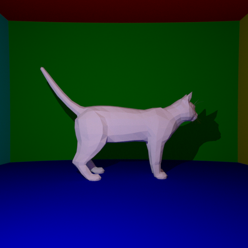
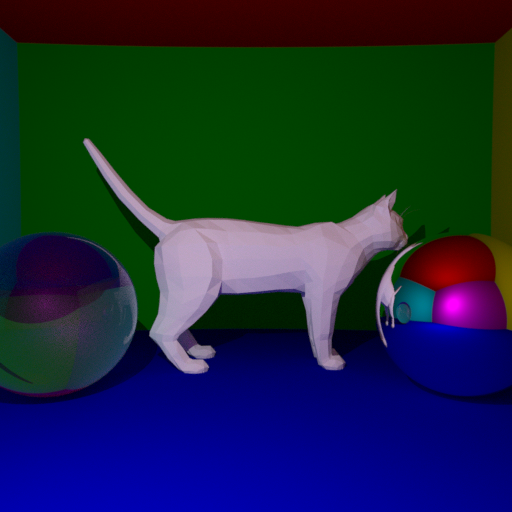
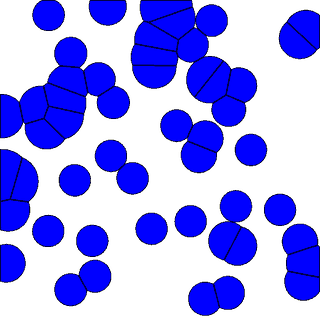

# C++ Rendering and Simulation

Two physically based graphics programs written from scratch in C++17 with no engine or
graphics API:

- **`path-tracer/`**: a Monte Carlo path tracer with global illumination, mirrors, glass and
  triangle meshes accelerated by a bounding volume hierarchy.
- **`ot-fluid/`**: a free-surface fluid simulated with semi-discrete optimal transport, where
  every step solves for a power diagram that gives each fluid particle the same area.

<p align="center">
  
  
  
</p>

## Path tracer

- Diffuse global illumination with cosine-weighted importance sampling, plus direct lighting
  from a point light with shadow rays.
- Perfect mirrors and glass with Schlick's Fresnel approximation and total internal reflection.
- Wavefront OBJ meshes intersected with the Möller-Trumbore test inside a median-split BVH.
- Gaussian pixel jitter for anti-aliasing and gamma-corrected 8-bit output.
- OpenMP parallel rendering. Every pixel owns its random number generator, so runs are free of
  data races and reproducible.

The 512 x 512 cat scene (3,954 triangles, 64 samples per pixel, 5 bounces) renders in about
10 s on a 10-core laptop.

## Optimal transport fluid

Each frame solves a semi-discrete optimal transport problem between the unit square and the
fluid particles plus an "air" phase:

1. **Power diagram.** Cells are built by clipping the unit square against the power bisector of
   every other particle (Sutherland-Hodgman), then intersecting with a disk whose radius comes
   from the air weight. This disk is what produces a free surface.
2. **Transport weights.** The weights maximize the concave dual of the transport problem, whose
   gradient is the gap between each cell's area and its target area. The maximization uses
   L-BFGS (liblbfgs).
3. **Dynamics.** A stiff spring pulls every particle toward the centroid of its cell, which keeps
   the fluid incompressible (Gallouët and Mérigot, 2018). Gravity and semi-implicit Euler
   integration advance the particles, which bounce off the walls of the box.

50 particles over 400 frames take about 90 s on a 10-core laptop. Each frame is written as a PNG.

## Build

Requires CMake 3.16+ and a C++17 compiler. OpenMP is optional.

```bash
cmake -S . -B build -DCMAKE_BUILD_TYPE=Release
cmake --build build -j
```

On macOS with Apple Clang, install OpenMP first and point CMake at it:

```bash
brew install libomp
cmake -S . -B build -DOpenMP_ROOT=$(brew --prefix libomp)
```

## Usage

```bash
# Path tracer
./build/path-tracer/path_tracer --samples 64 --depth 5 --output render.png
./build/path-tracer/path_tracer --mirror-sphere --glass-sphere --output spheres.png

# Fluid: writes frames/frame_0000.png ... frames/frame_0399.png
./build/ot-fluid/ot_fluid --particles 50 --frames 400 --output-dir frames
ffmpeg -framerate 25 -i frames/frame_%04d.png -pix_fmt yuv420p fluid.mp4   # optional video
```

## Layout

```
path-tracer/src   vec3, ray, rng, shape, sphere, aabb, triangle_mesh (OBJ + BVH), scene (shading), camera, main
path-tracer/assets   cat.obj
ot-fluid/src      vec2, polygon, power_diagram, optimal_transport (L-BFGS dual), fluid, frame_writer, main
third_party       stb_image_write, liblbfgs
```

## References

- T. Gallouët and Q. Mérigot. A Lagrangian scheme à la Brenier for the incompressible Euler
  equations. *Foundations of Computational Mathematics*, 2018.
- B. Lévy. A numerical algorithm for L2 semi-discrete optimal transport in 3D. *ESAIM: M2AN*, 2015.
- T. Möller and B. Trumbore. Fast, minimum storage ray-triangle intersection. *Journal of Graphics
  Tools*, 1997.
- C. Schlick. An inexpensive BRDF model for physically-based rendering. *Computer Graphics Forum*, 1994.

## Third-party code and assets

- [stb_image_write](https://github.com/nothings/stb) (public domain or MIT) for PNG output.
- [liblbfgs](https://github.com/chokkan/liblbfgs) by Naoaki Okazaki (MIT), see
  `third_party/liblbfgs/COPYING`.
- The cat model was downloaded from cadnav.com.

## License

MIT, see [LICENSE](LICENSE). Third-party components keep their own licenses.
